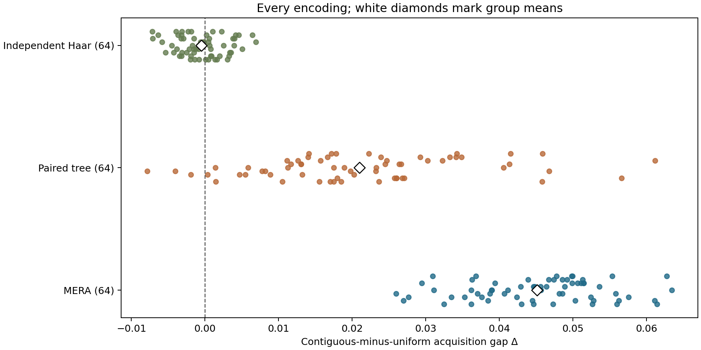
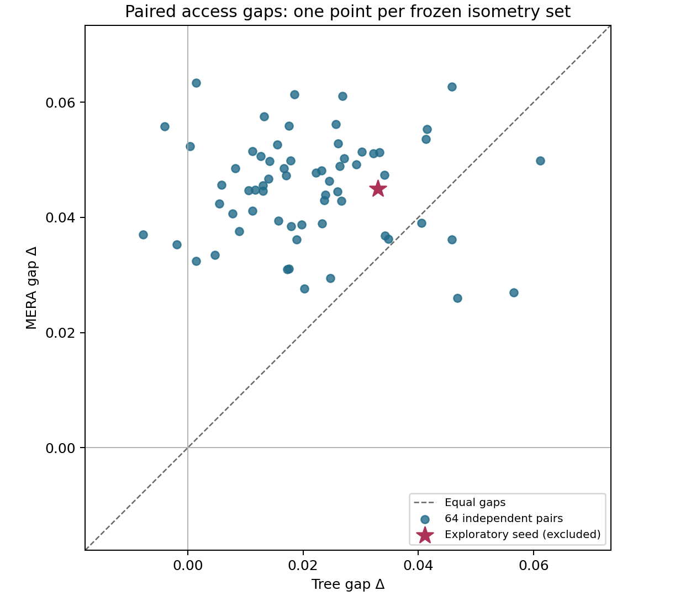
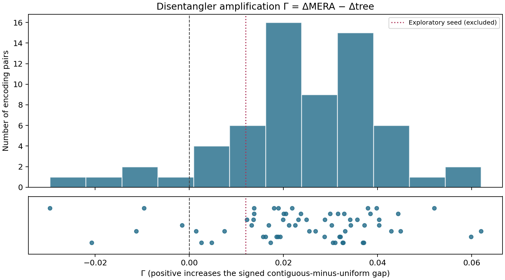
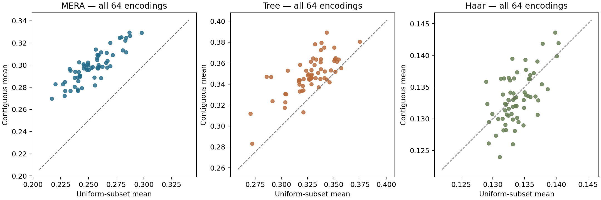

# Eight-site random-encoding ensemble

## Two primary questions

The study contains 64 independent MERA draws, their 64 paired identity-disentangler trees, and 64 independent Haar-isometry controls. Each encoding uses a Bell reference and the same flagged three-site access ensembles. The separate seed 20260918 is excluded from every ensemble estimate.

| Primary estimand | Mean | Approximate percentile 95% interval | Separate assessment |
|---|---:|---|---|
| Delta_MERA | +0.0451095417 | [+0.0429240981, +0.0472599932] | positive mean supported by this interval |
| Gamma | +0.0241266868 | [+0.0199294479, +0.0281299624] | positive mean supported by this interval |

Delta_MERA answers whether contiguous access has a positive mean advantage in the declared MERA distribution. Gamma answers whether the specified disentanglers increase the signed gap relative to paired trees. These questions are assessed separately; there is no omnibus success criterion.

Intervals use 20,000 encoding-level bootstrap resamples. They approximate Monte Carlo uncertainty for these declared random-encoding distributions. MERA/tree pairs are resampled together, and Haar draws independently. No multiplicity adjustment is applied. The 56 overlapping subsets are not independent replicates.

## Gaps and amplification

| Quantity | Mean | Sample SD | Median | IQR | Minimum | Maximum | Positive / unresolved / negative |
|---|---:|---:|---:|---:|---:|---:|---|
| Delta_MERA | +0.04510954 | 0.00899585 | +0.04600217 | 0.01248493 | +0.02598128 | +0.06342734 | 64 / 0 / 0 |
| Delta_tree | +0.02098285 | 0.01410037 | +0.01869421 | 0.01445823 | -0.00783999 | +0.06114667 | 61 / 0 / 3 |
| Delta_Haar | -0.00050647 | 0.00321890 | -0.00069335 | 0.00439936 | -0.00716381 | +0.00688512 | 27 / 0 / 37 |
| Gamma | +0.02412669 | 0.01690565 | +0.02520955 | 0.01746721 | -0.02962554 | +0.06201085 | 59 / 0 / 5 |

Sign counts use 1e-8 as a numerical-resolution threshold, not an effect-size threshold. All negative gaps and negative amplification values remain in the results.

## Acquisition levels

| Encoder | Mean contiguous acquisition | Mean uniform-subset acquisition |
|---|---:|---:|
| mera | 0.2988454134 | 0.2537358717 |
| tree | 0.3486754025 | 0.3276925477 |
| haar | 0.1332757010 | 0.1337821700 |

L_C, measured as MERA minus tree, averages -0.0498299891, with approximate percentile 95% interval [-0.0550498780, -0.0444635540].

L_U, measured as MERA minus tree, averages -0.0739566760, with approximate percentile 95% interval [-0.0797634450, -0.0681253731].

A larger gap does not imply more total acquisition. The two level changes are reported independently, and Gamma = L_C − L_U.

## Independent Haar comparison

Haar controls match the logical and boundary dimensions, but not locality or tensor structure. Their seed indices do not pair them scientifically with structured encodings. A Haar draw can have a nonzero gap; permutation symmetry gives zero ensemble expectation, not an exact-zero sample requirement.

| Independent contrast | Mean difference | Approximate percentile 95% interval |
|---|---:|---|
| mera_minus_Haar_gap | +0.0456160107 | [+0.0432935863, +0.0478917576] |
| mera_minus_Haar_C | +0.1655697124 | [+0.1619233347, +0.1692354918] |
| mera_minus_Haar_U | +0.1199537017 | [+0.1156659155, +0.1242748337] |
| tree_minus_Haar_gap | +0.0214893239 | [+0.0180427034, +0.0250672944] |
| tree_minus_Haar_C | +0.2153997015 | [+0.2108831556, +0.2197749549] |
| tree_minus_Haar_U | +0.1939103777 | [+0.1890078200, +0.1986393721] |

The Haar mean gap is -0.0005064690, with interval [-0.0012832085, +0.0002980556]. These contrasts describe the specified ensembles rather than isolating a universal causal property of multiscale structure.

## Exploratory seed placement

| Quantity | Seed 20260918 value | Empirical percentile among 64 ensemble draws | Within observed range | Within sample IQR |
|---|---:|---:|---|---|
| Delta_MERA | +0.0449452220 | 46.88 | True | True |
| Delta_tree | +0.0329640357 | 81.25 | True | False |
| Gamma | +0.0119811863 | 14.06 | True | False |
| L_C | -0.0465915863 | 64.06 | True | True |
| L_U | -0.0585727726 | 73.44 | True | True |

The exploratory MERA gap lies at the 46.875th empirical percentile and inside the ensemble sample’s interquartile range, making that gap representative of the sample center. Its tree gap is at the 81.25th percentile and its amplification at the 14.0625th percentile, both outside their sample interquartile ranges. The seed's positive amplification was therefore smaller than most ensemble paired effects.

This is a descriptive assessment of representativeness relative to this sample, not a population outlier test. Seed 20260918 appears as a separate marked reference in figures and never enters the estimates or resamples.

## Complementary access

Purity of the Bell-reference state gives I(Q:B_S)+I(Q:B_Sc)=2, hence r(S)+r(Sc)=1. Complementing the eight cyclic triples gives the eight cyclic five-site windows; complementing all 56 triples gives all 56 five-site subsets. Both five-site ensemble means are therefore one minus their three-site counterparts, so Delta_5 = −Delta_3. This is an algebraic consequence of the same states and access rules, not additional independent evidence.

## Validation and execution

All 192 ensemble encoders passed at 1e-10. The largest validation residual was 5.209e-13; the complementary-gap residual was at most 9.936e-15. The separate exploratory regression reproduced within 0.000e+00.

Every MERA/tree pair retained separate contraction and dense encodings and two partial-trace implementations. Haar used both partial traces. Checks covered tensor/full isometry, normalization, density validity, empty/full reference information, and complementary information. Raw eigenvalues are retained, including tolerated negatives; only negative eigenvalues contribute zero to entropy, while all positive eigenvalues are kept. Scores are not rounded or clipped to force agreement.

The sampling plan preceded acquisition evaluation, and no seed was replaced. Tensor draws use the declared seeds and generation conventions. Complete per-subset results, per-encoding and paired summaries, validation records, and tensor archives are included.

Measured execution after imports: 101.68 wall seconds; 89.28 CPU seconds; 126.1 MiB sampled peak RSS. Budget per process: 30 minutes and 2 GiB.

The study concerns random, unoptimized encodings of fixed size. It does not establish a physical ground state, an Ising result, optimal decoding fidelity, retrieval latency, or prevalence outside the declared random-encoding distributions.

## Separate conclusions

**Access preference:** positive mean supported by this interval; mean MERA gap +0.0451095417.

**Disentangler amplification:** positive mean supported by this interval; mean Gamma +0.0241266868. Acquisition-level changes remain separate: mean L_C -0.0498299891, mean L_U -0.0739566760.

**Haar comparison:** positive structured-minus-Haar mean contrast supported by this interval; mean MERA-minus-Haar gap contrast +0.0456160107. The independent Haar distribution matches dimensions but changes both locality and tensor structure.
